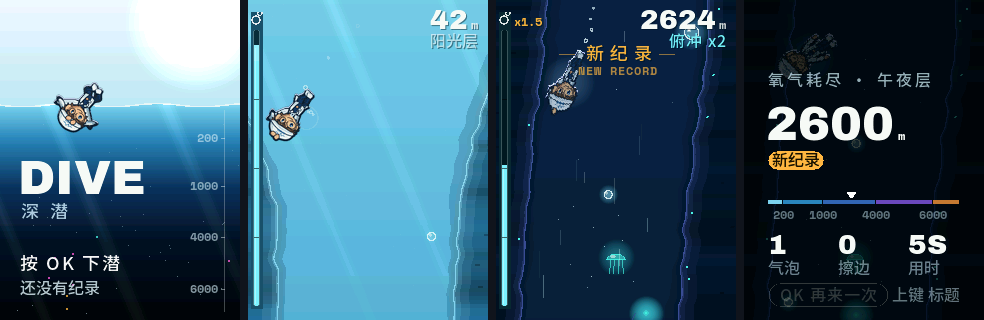

# 深潜 DIVE

NABO 的单键下潜游戏：按一下换方向，在岩壁、水母和鮟鱇之间“之”字下潜；氧气一直在减少，越深越快，吃上浮的气泡补氧，擦边躲过有奖励，氧气归零后还有 1.5 秒“最后一口气”。从阳光层一路潜到海沟，越深越暗。

为 FoloToy AI Passport 工牌（ESP32-C3，240×320）设计。固件在 [ai-passport-nabo-xiaozhi-dive](https://github.com/Liutupi/ai-passport-nabo-xiaozhi-dive)，本仓库放游戏的美术、Codex 美术流程和网页原型。



## 内容

| 目录 / 文件 | 说明 |
|---|---|
| `ART_BRIEF.md` | 美术规格：硬件约束、骨骼拼接动画、帧清单、交付结构、验收清单 |
| `CODEX_PROMPTS.md` | 交给 Codex 的分轮提示词（造型 → 骨骼与划水 → 其余动作 → 生物与界面） |
| `manifest.json` | 帧清单：三套皮肤 × 9 组动作（划水、俯冲进/循环/出、吃气泡、撞到、缺氧、结束、转身） |
| `frames/<皮肤>/<动作>/` | 256×256 RGBA 帧，锚点 (128,128)，标准朝向往左下约 50° |
| `rig/`、`tools/` | SVG 部件、支点与时间轴，以及重新渲染全部帧的脚本（见 `tools/README.md`） |
| `design/` | 第 1 轮三个造型方案与 56 px 可读性检查 |
| `prototype/` | 网页原型：玩法、手感调参、RGB565 色彩模拟、实机 SPI 预算估算 |

`history/`、`preview/` 和 Codex 每轮的 zip 不入库。

## 网页原型

用浏览器直接打开 `prototype/index.html`。OK / 空格换方向，按住 ↓ 俯冲，↑ 暂停。右侧可以调速度、耗氧、气泡和障碍密度，切换三套皮肤、水下光照和深色描边。

更新帧之后重新生成原型用的图集：

```sh
python3 prototype/build_atlas.py
```

## 进入固件

把本仓库克隆到固件仓库旁边，在固件仓库里运行：

```sh
python3 tools/generate_dive_sprites.py --skin a --source ../nabo-dive
```

它把选定皮肤的帧缩到 66 px，量化成 64 色调色板（带透明度和顶部受光强度），逐帧压缩，生成 `nabo_dive_sprites.c/.h`。深度染色和受光边由固件按海域改写调色板完成。

## 许可

代码 MIT；NABO 形象与美术不随 MIT 授权，见 [NOTICE.md](NOTICE.md)。
